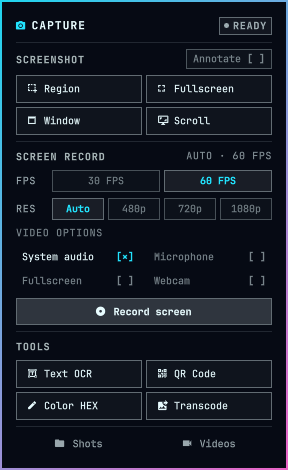

# Capture Toolkit

A compact, retro-minimalist bar widget plugin for [Omarchy](https://omarchy.org/) that gathers Omarchy's native capture and recording utilities into one keyboard-friendly panel.



## Features

- **Screenshots:** Region (`1`), Fullscreen (`2`), Window (`3`), Scroll (`4`), plus an `Annotate [ ]` (`e`) toggle (`--editor=overlay`) for drawing arrows, text, or blurring before saving
- **Configurable Screen Recording:**
  - **FPS selector:** `30 FPS` / `60 FPS` (`p`)
  - **Resolution selector:** `Auto` (native) / `480p` / `720p` / `1080p` (`s`)
  - **Video options:** Clean borderless checkboxes for `System audio` (`a`), `Microphone` (`m`), `Fullscreen` (`f`, unchecked selects a region), and `Webcam` (`w`) with initial overlay size `S` / `M` / `L` (`z`)
  - **Live recording controls:** Active `REC` indicator on the bar, one-click Stop (`r`), and live webcam resize controls (`-`, `0`, `+`)
- **Persistent Preferences:** Automatically saves your last capture and recording settings to `${XDG_STATE_HOME:-$HOME/.local/state}/omarchy/capture-toolkit-settings.json`
- **Descriptive Hover Tooltips:** Hover any button or option to see what it does along with its keyboard shortcut
- **Dependency Health Footer:** Automatically checks for `gpu-screen-recorder` / `wf-recorder` and `hyprpicker`, displaying a themed error notice in the panel footer if a required tool is missing
- **Utilities & Quick Folders:** OCR Text Capture (`t`), QR Code Reader (`q`), Color Picker (`c`), Media Transcoder (`v`), and direct links to Screenshots and Videos folders
- **Bar Shortcuts:** Left-click toggles the panel; right-click takes a quick smart screenshot (or stops an active recording)
- **Theme & i18n Ready:** Uses Omarchy `qs.Ui` / `qs.Commons` theme tokens (dark and light themes), respects `omarchy toggle animations`, and supports `en`, `pt-BR`, and `pt`

## Installation

```bash
omarchy plugin add https://github.com/ArchGuima/omarchy-capture-toolkit --enable
omarchy bar put archguima.capture-toolkit --section right
```

## Removal

```bash
omarchy plugin remove archguima.capture-toolkit
```

## Dependencies

Uses only unprivileged tools bundled with Omarchy:

- `omarchy-capture-screenshot`, `omarchy-capture-screenrecording`, `omarchy-capture-webcam-resize`, `omarchy-capture-text`, `omarchy-capture-qr`, `omarchy-transcode`, `omarchy-hw-webcam`
- `gpu-screen-recorder` (recommended, required for custom `480p`/`720p`/`1080p` scaling) or `wf-recorder`
- `hyprpicker` (color picker)
- `xdg-user-dir` and `xdg-open` (opening Screenshots and Videos folders)

## Keyboard Navigation

| Key | Action |
| :--- | :--- |
| `Arrows` / `hjkl` | Move cursor across tiles and options |
| `Enter` / `Space` | Activate focused item |
| `Esc` | Close panel |
| `Tab` / `Shift+Tab` | Switch to adjacent bar panels |
| `1` `2` `3` `4` | Region / Fullscreen / Window / Scroll screenshot |
| `e` | Toggle annotation overlay for screenshots |
| `p` | Toggle recording FPS (`30` / `60`) |
| `s` | Cycle recording resolution (`Auto` / `480p` / `720p` / `1080p`) |
| `a` `m` `f` `w` | Toggle System audio / Microphone / Fullscreen / Webcam |
| `z` | Cycle initial webcam size (`S` / `M` / `L`) when Webcam is enabled |
| `r` | Start or stop screen recording |
| `-` `0` `+` | Resize active webcam overlay while recording |
| `t` `q` `c` `v` | OCR / QR Code / Color HEX / Transcode |

## Optional Hyprland Keybinding

Add to `~/.config/hypr/bindings.lua`:

```lua
o.bind("SUPER + ALT + C", "Capture Toolkit", { panel = "archguima.capture-toolkit" })
```

## Security & Privacy

- Unprivileged user-space tools only — zero privilege escalation, zero package or service management, zero network requests
- Strict `hasOwnProperty` allowlists for all commands and persisted settings (`Model.js`)
- Defense-in-depth flag allowlist and canonical-path / inode recursion guards in `scripts/record-with-fps.sh` and `shims/`
- Plain-text rendering (`Text.PlainText`) and markup neutralization on every tooltip
- Safe folder opening via `xdg-user-dir` without sourcing shell files

## Development & Tests

```bash
omarchy plugin validate .
node --test tests/model.test.mjs
```
